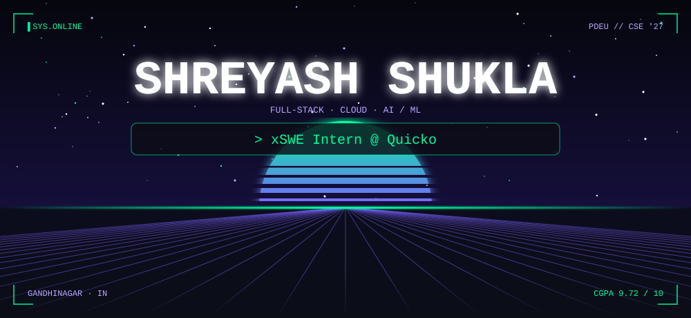

  
    
  <a href="https://shreyashshukla.vercel.app/">Portfolio</a> &nbsp;·&nbsp;
  <a href="https://www.linkedin.com/in/shreyash-shukla-6a3b5a309/">LinkedIn</a> &nbsp;·&nbsp;
  <a href="mailto:shreyash.shukla.dev@gmail.com">Email</a> &nbsp;·&nbsp;
  <a href="https://leetcode.com/u/shreyash_shukla">LeetCode</a> &nbsp;·&nbsp;
  <a href="https://codeforces.com/profile/shreyash.ext">Codeforces</a>

I study Computer Science at PDEU (class of 2027). My work spans serverless backends, full-stack products, and applied machine learning. I like building things that move from an idea to a working product.

## Experience

**Software Engineering Intern, [Quicko](https://quicko.com)** · May–June 2026 · Ahmedabad

- Shipped [PAN Verification](https://quicko.com/tools/verify-pan-details), [PAN–Aadhaar Link Checker](https://quicko.com/tools/check-pan-aadhaar-link-status), [Tax Payment Checker](https://quicko.com/tools/check-tax-payment-status), and [e-Verify ITR](https://quicko.com/tools/e-verify-itr).
- Built serverless APIs with TypeScript, Node.js, AWS Lambda, and DynamoDB. Defined contracts with OpenAPI and JSON Schema and provisioned infrastructure with Terraform.

## Featured projects

<table>
  <tr>
    <td width="50%"></td>
    <td width="50%"></td>
  </tr>
  <tr>
    <td width="50%"></td>
    <td width="50%"></td>
  </tr>
</table>

## Toolbox

| Languages | Backend and web | Infrastructure and data |
| --- | --- | --- |
| Python, TypeScript, JavaScript, C++, Java, SQL | Node.js, Next.js, React, FastAPI, Express, Flask | AWS, Terraform, Docker, PostgreSQL, MongoDB, MySQL |

## Beyond the work

- First place at HackNUthon 6.0; second place at Breach 2025.
- LeetCode Knight; GATE qualified; 9.72/10 CGPA at PDEU.
- Government of Gujarat Merit Scholarship and NPTEL certification from IIT Bombay.
- Volunteer work in education and bird conservation.
