<div align="center">


<br/><br/>

<a href="https://shreyashshukla.vercel.app/"></a>
<a href="https://www.linkedin.com/in/shreyash-shukla-6a3b5a309/"></a>
<a href="https://github.com/Shreyash-Shukla"></a>
<a href="https://leetcode.com/u/shreyash_shukla"></a>
<a href="https://codeforces.com/profile/shreyash.ext"></a>
<a href="mailto:shreyash.shukla.dev@gmail.com"></a>

</div>



```cpp
class ShreyashShukla {
public:
    string university   = "Pandit Deendayal Energy University (PDEU)";
    string degree       = "B.Tech — Computer Science & Engineering ('23 - '27)";
    float  cgpa         = 9.72;
    string location     = "Gandhinagar, Gujarat, India";

    // Experience & Highlights
    string experience   = "xSWE Intern @ Quicko";
    string codingRating = "Knight Badge @ LeetCode";

    vector<string> currently = {
        "Engineering cloud-native serverless backends & microservices (AWS Lambda, DynamoDB)",
        "Building AI orchestration & fraud prevention systems (RAG, DAGs, GNNs, FastAPI)",
        "Developing scalable full-stack web applications with Next.js & TypeScript"
    };

    string motto = "Code it. Ship it. Improve it.";
};
```



**Software Engineering Intern — [Quicko](https://quicko.com)** · *May 2026 — June 2026 · Ahmedabad, Gujarat*

- Shipped **4 production-grade financial tools** live on Quicko: [PAN Verification](https://quicko.com/tools/verify-pan-details), [PAN-Aadhaar Link Checker](https://quicko.com/tools/check-pan-aadhaar-link-status), [Tax Payment Checker](https://quicko.com/tools/check-tax-payment-status), and [e-Verify ITR](https://quicko.com/tools/e-verify-itr).
- Architected cloud-native workflows on **AWS DynamoDB** and high-throughput serverless APIs using **TypeScript**, **Node.js**, and **AWS Lambda** with Middy middleware.
- Implemented **OpenAPI Specifications** and **JSON Schemas** with automated code generation, and provisioned IaC using **Terraform** and **AWS IAM**.



<br/>





<div align="center">

<table>
  <tr>
    <td width="50%" align="center">
      <a href="https://github.com/Shreyash-Shukla/FraudShield"></a>
      <br/><a href="https://github.com/Shreyash-Shukla/FraudShield"><b>View Repository ↗</b></a>
    </td>
    <td width="50%" align="center">
      <a href="https://github.com/Shreyash-Shukla/TrustChain"></a>
      <br/><a href="https://github.com/Shreyash-Shukla/TrustChain"><b>View Repository ↗</b></a>
    </td>
  </tr>
  <tr>
    <td width="50%" align="center">
      <a href="https://github.com/Shreyash-Shukla/DAGent"></a>
      <br/><a href="https://github.com/Shreyash-Shukla/DAGent"><b>View Repository ↗</b></a>
    </td>
    <td width="50%" align="center">
      <a href="https://github.com/Shreyash-Shukla/DriveMesh"></a>
      <br/><a href="https://github.com/Shreyash-Shukla/DriveMesh"><b>View Repository ↗</b></a>
    </td>
  </tr>
</table>

</div>


```yaml
volunteer:
  - Taught underprivileged children through academic support initiatives
  - Supported bird conservation with NGOs and awareness campaigns
  - Community service focused on social impact & environmental sustainability

fun_facts:
  - I debug with print statements AND a debugger
  - My rubber duck has a CS degree by now
  - It works on my machine, and I make it work on yours too
  - Coffee -> Code -> Repeat
```

