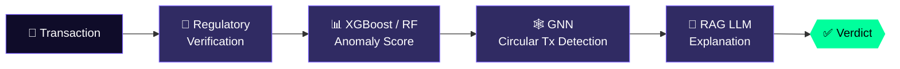
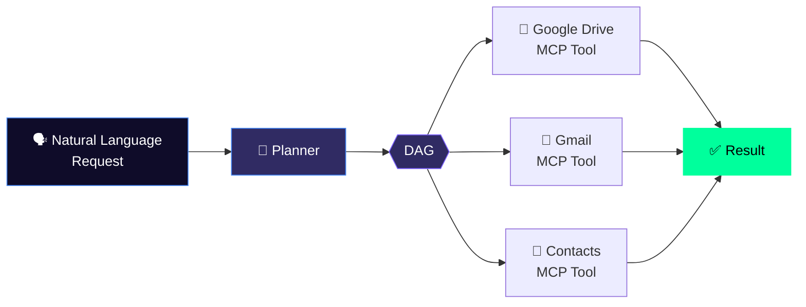
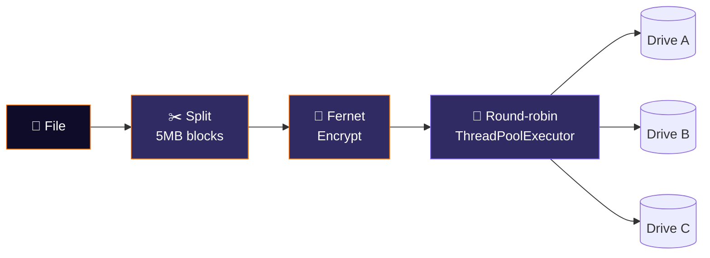

<div align="center">

<!-- ✨ Animated twinkling header -->


<!-- ⌨️ Terminal typing -->
<a href="https://git.io/typing-svg">
  
</a>

<br/>


<br/><br/>

[](https://shreyashshukla.vercel.app/)
[](https://www.linkedin.com/in/shreyash-shukla-6a3b5a309/)
[](https://github.com/Shreyash-Shukla)
[](https://leetcode.com/u/shreyash_shukla)
[](https://codeforces.com/profile/shreyash.ext)
[](mailto:shreyash.shukla.dev@gmail.com)


</div>


<div align="center">
  
</div>

```bash
shreyash@pdeu:~$ whoami
> Shreyash Shukla — B.Tech CSE '27 @ Pandit Deendayal Energy University
> CGPA 9.72 / 10.0  |  Gandhinagar, Gujarat 🇮🇳
> LeetCode Knight ♞  |  GATE Qualified ✔
> xSWE Intern @ Quicko
```

```cpp
class ShreyashShukla {
public:
    string university   = "Pandit Deendayal Energy University (PDEU)";
    string degree       = "B.Tech — Computer Science & Engineering ('23 - '27)";
    float  cgpa         = 9.72;
    string location     = "Gandhinagar, Gujarat 🇮🇳";

    // Experience & Highlights
    string experience   = "xSWE Intern @ Quicko";
    string codingRating = "Knight Badge @ LeetCode";

    vector<string> currently = {
        "Engineering cloud-native serverless backends & microservices (AWS Lambda, DynamoDB)",
        "Building AI orchestration & fraud prevention systems (RAG, DAGs, GNNs, FastAPI)",
        "Developing scalable full-stack web applications with Next.js & TypeScript"
    };

    string motto = "Code it. Ship it. Improve it.";
};
```


<div align="center">
  
</div>

<div align="center">

<table>
  <tr>
    <td>
      <h3 align="left">🚀 Software Engineering Intern — <a href="https://quicko.com">Quicko</a></h3>
      <p align="left"><em>May 2026 — June 2026 &nbsp;|&nbsp; Ahmedabad, Gujarat</em> &nbsp; </p>
      <ul>
        <li>Shipped <b>4 production-grade financial tools</b> live on Quicko: <a href="https://quicko.com/tools/verify-pan-details">PAN Verification</a>, <a href="https://quicko.com/tools/check-pan-aadhaar-link-status">PAN-Aadhaar Link Checker</a>, <a href="https://quicko.com/tools/check-tax-payment-status">Tax Payment Checker</a>, and <a href="https://quicko.com/tools/e-verify-itr">e-Verify ITR</a>.</li>
        <li>Architected cloud-native workflows on <b>AWS DynamoDB</b> and high-throughput serverless APIs using <b>TypeScript</b>, <b>Node.js</b>, and <b>AWS Lambda</b> with Middy middleware.</li>
        <li>Implemented <b>OpenAPI Specifications</b> and <b>JSON Schemas</b> with automated code generation, and provisioned IaC using <b>Terraform</b> and <b>AWS IAM</b>.</li>
      </ul>
    </td>
  </tr>
</table>

</div>


<div align="center">
  

<br/>


<br/>

| 🏅 | Achievement | Highlights |
|---|---|---|
| 🥇 | **1st Place** — HackNUthon 6.0 | Ranked 1st out of **300+ teams & 1000+ participants** |
| 🥈 | **2nd Place** — Breach 2025 | AI + Blockchain Fraud Prevention Platform |
| ♞ | **Knight Badge** — LeetCode | Top competitive programming tier |
| 🎓 | Qualified **JEE Mains, JEE Advanced & GATE** | Prestigious national engineering & graduate examinations |
| 🎖️ | **Government of Gujarat Merit Scholarship** | Awarded for academic excellence (CGPA: 9.72 / 10.0) |
| 📜 | **NPTEL Certification** — IIT Bombay | Entrepreneurship & Incubation |

</div>


<div align="center">
  

<br/>

**Languages**<br/>
<br/><br/>

**Frontend & Backend**<br/>
<br/><br/>

**Cloud, DevOps & Databases**<br/>
<br/><br/>

**AI, ML & Tools**<br/>


</div>


<div align="center">
  
</div>

<div align="center">

<table>
  <tr>
    <td width="50%" valign="top">
      
      <h3 align="center">🛡️ AI Fraud Detection</h3>
      <p align="center">
        <b>🏆 1st Place — HackNUthon 6.0 (300+ Teams)</b><br/><br/>
        
        
        
        
      </p>
      <p>Compliance-first transaction fraud detection pipeline combining banking regulatory verification, XGBoost/Random Forest anomaly scoring, Graph Neural Networks (GNNs) for circular transactions, and RAG-based LLM explanations.</p>
      <p align="center">
        <a href="https://github.com/Shreyash-Shukla/FraudShield"></a>
      </p>
    </td>
    <td width="50%" valign="top">
      
      <h3 align="center">⛓️ Fraud Prevention</h3>
      <p align="center">
        <b>🥈 2nd Place — Breach 2025</b><br/><br/>
        
        
        
        
      </p>
      <p>Multi-layer fraud prevention platform integrating biometric facial authentication (OpenCV, DeepFace), Random Forest transaction classifier trained on Ethereum data, and immutable Solidity smart contracts on blockchain.</p>
      <p align="center">
        <a href="https://github.com/Shreyash-Shukla/TrustChain"></a>
      </p>
    </td>
  </tr>
  <tr>
    <td width="50%" valign="top">
      
      <h3 align="center">🤖 AI Workflow Orchestration</h3>
      <p align="center">
        
        
        
        
      </p>
      <p>Autonomous AI orchestration engine converting natural language requests into parallel executable DAG workflows. Integrates Model Context Protocol (MCP) tools for Google Drive, Gmail, and Contacts with OAuth 2.0.</p>
      <p align="center">
        <a href="https://github.com/Shreyash-Shukla/DAGent"></a>
      </p>
    </td>
    <td width="50%" valign="top">
      
      <h3 align="center">☁️ Distributed Cloud Storage</h3>
      <p align="center">
        
        
        
        
      </p>
      <p>Aggregates multiple Google Drive accounts into unified encrypted storage. Splits files into 5MB blocks encrypted with Fernet and distributes them round-robin via ThreadPoolExecutor with multi-account OAuth 2.0 token refresh.</p>
      <p align="center">
        <a href="https://github.com/Shreyash-Shukla/DriveMesh"></a>
      </p>
    </td>
  </tr>
</table>

</div>

<details>
<summary><b>⚙️ Under the hood — click to see how these systems flow</b></summary>

<br/>

**🛡️ FraudShield pipeline**



**🤖 DAGent workflow**



**☁️ DriveMesh storage**



</details>


<div align="center">
  

<br/>


<br/>


<br/>


<br/><br/>


<br/>

<!-- 🐍 Needs the snake.yml workflow (see .github/workflows/snake.yml) -->
<picture>
  <source media="(prefers-color-scheme: dark)" srcset="https://raw.githubusercontent.com/Shreyash-Shukla/Shreyash-Shukla/output/github-snake-dark.svg" />
  <source media="(prefers-color-scheme: light)" srcset="https://raw.githubusercontent.com/Shreyash-Shukla/Shreyash-Shukla/output/github-snake.svg" />
  
</picture>

</div>


<div align="center">
  
</div>

```yaml
volunteer:
  - Taught underprivileged children through academic support initiatives
  - Supported bird conservation with NGOs and awareness campaigns
  - Community service focused on social impact & environmental sustainability

fun_facts:
  - I debug with print statements AND a debugger 🐛
  - My rubber duck has a CS degree by now 🦆
  - Coffee → Code → Repeat ☕
```

<div align="center">


</div>
